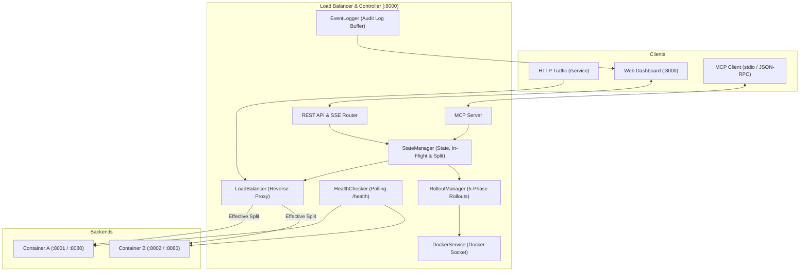

# Docker Load Balancer with MCP Controls

Zero-downtime HTTP load balancer routing traffic between two Docker containers (A and B) with dual control planes: a real-time web dashboard and a Model Context Protocol (MCP) server for AI agents.

---

## Quickstart

### Prerequisites
- Docker & Docker Compose (v2.0+)
- Node.js 20+ (optional, for local CLI/tests)

### Run Everything
```bash
docker compose up --build
```

### Access Points
- **Web Dashboard**: `http://localhost:8000`
- **Ingress Service**: `http://localhost:8000/service`
- **REST API**: `http://localhost:8000/api/status`
- **Live SSE Feed**: `http://localhost:8000/api/events`

---

## Architecture

Both the Web Dashboard and MCP Client share identical controller logic and in-memory state.



### Core Modules
- **StateManager**: Single source of truth for container health, in-flight requests, and traffic split computation.
- **LoadBalancer**: Proxies HTTP traffic based on effective split, tracking in-flight requests and setting tracking headers.
- **HealthChecker**: Background polling of container `/health` endpoints (1s interval).
- **RolloutManager**: Orchestrates 5-phase safe rollouts, health polling, connection draining, and automatic rollback on failure.
- **EventLogger**: In-memory ring buffer (200 logs) broadcasting real-time audit events via SSE.
- **DockerService**: Manages container lifecycles via Docker Engine socket.

---

## Required Behaviors & Safety Invariants

| Case | Required Behaviour | Implementation |
|---|---|---|
| **Traffic Split** | Percentages must sum to 100 ($S_A + S_B = 100$). | Rejects non-numeric or unbalanced values with HTTP 400. |
| **Routing** | Requests go only to healthy containers that are not draining. | Load balancer evaluates effective split dynamically; excludes draining/unhealthy containers. |
| **One Container Unhealthy** | Temporarily send all traffic to the other; show effective split and log it. | Effective split shifts 100% to healthy container. Configured split is preserved and restored upon recovery. |
| **Neither Container Healthy** | Return a service-unavailable response. | Ingress returns `HTTP 503 Service Unavailable`. |
| **Invalid Split** | Reject any split that routes to a stopped, unhealthy, or draining container. | Rejects update with HTTP 400 and logs `TRAFFIC_SPLIT_REJECTED`. |
| **Stop Container** | Remove from routing -> let in-flight requests finish -> stop container. | Sets status to `DRAINING`, waits for active connections to finish (`waitForDrain`), then stops container. |
| **Stopping Last Healthy Container** | Reject operation. | Rejects with HTTP 400 if the alternate container is not running and healthy. |
| **Drain Timeout** | Report an error; keep container running but send no new requests. | Logs `CONTAINER_DRAIN_TIMEOUT` after 5s; keeps container alive to finish requests while isolated from routing. |
| **Safe Rollout (5 Phases)** | Start target -> wait healthy -> move traffic -> drain old -> stop old. | Sequential zero-downtime execution with live progress reporting. |
| **Rollout Timeout / Failure** | Abort; traffic stays on old container. | Rollout aborts if target fails health checks within timeout. 100% traffic maintained on healthy source container. |
| **During a Rollout** | Reject any conflicting change. | Rollout mutex rejects manual split changes, container stops, or starts with HTTP 409 Conflict. |

---

## Configured Timeouts

| Parameter | Env Variable | Default | Description |
|---|---|---|---|
| Health Check Interval | `HEALTH_CHECK_INTERVAL_MS` | `1000ms` | Frequency of background health probes. |
| Health Check Timeout | `HEALTH_CHECK_TIMEOUT_MS` | `1500ms` | Probe timeout before marking attempt failed. |
| Drain Timeout | `DRAIN_TIMEOUT_MS` | `5000ms` | Maximum wait time for in-flight requests during container stop. |
| Rollout Health Timeout | `ROLLOUT_HEALTH_TIMEOUT_MS` | `12000ms` | Timeout for target container readiness during rollout before aborting. |
| Proxy Timeout | `PROXY_TIMEOUT_MS` | `10000ms` | Ingress proxy gateway timeout before returning HTTP 504. |

---

## MCP Client Configuration

The MCP server runs over standard I/O (stdio) using `@modelcontextprotocol/sdk`. Every MCP action is logged with `source: "mcp"`.

### Claude Desktop (`claude_desktop_config.json`)
```json
{
  "mcpServers": {
    "docker-load-balancer": {
      "command": "npx",
      "args": ["-y", "tsx", "/absolute/path/to/Botpresso/src/mcp/stdio-runner.ts"],
      "env": {
        "PORT": "8000",
        "DOCKER_SOCKET_PATH": "/var/run/docker.sock"
      }
    }
  }
}
```

### Cursor / Antigravity (`mcp.json`)
```json
{
  "mcpServers": {
    "docker-load-balancer": {
      "command": "npx",
      "args": ["-y", "tsx", "./src/mcp/stdio-runner.ts"]
    }
  }
}
```

---

## API & MCP Tool Reference

### MCP Tools

| Tool | Parameters | Description |
|---|---|---|
| `get_status` | *None* | Returns state, health, split, in-flight counts, metrics, and errors. |
| `set_traffic_split` | `splitA: number, splitB: number` | Updates traffic split percentages (must sum to 100). |
| `start_container` | `container: "A" \| "B", timeoutMs?: number` | Starts container and polls readiness until healthy. |
| `stop_container` | `container: "A" \| "B"` | Drains in-flight requests and stops container. Rejects if last healthy backend. |
| `safe_rollout` | `from: "A" \| "B", to: "A" \| "B"` | Executes 5-phase zero-downtime rollout. |
| `get_recent_logs` | `limit?: number, source?: string` | Returns audit logs filtered by source (`mcp`, `dashboard`, `controller`). |
| `force_container_unhealthy` | `container: "A" \| "B", unhealthy: boolean` | Chaos helper to force 503 health check responses. |
| `control_traffic_generator` | `action: "start" \| "stop" \| "set_rpm", rpm?: number` | Controls built-in traffic generator. |

### REST Endpoints

| Method | Endpoint | Description |
|---|---|---|
| `GET` | `/api/status` | Complete system state snapshot. |
| `GET` | `/api/metrics` | Request metrics, latencies, and traffic generator stats. |
| `POST` | `/api/split` | Set traffic split: `{"splitA": 80, "splitB": 20}`. |
| `POST` | `/api/containers/:id/start` | Start Container A or B. |
| `POST` | `/api/containers/:id/stop` | Gracefully drain and stop Container A or B. |
| `POST` | `/api/containers/:id/chaos` | Chaos actions: `{"action": "unhealthy" \| "healthy" \| "delay", "delayMs": 3000}`. |
| `POST` | `/api/rollout` | Trigger rollout: `{"from": "A", "to": "B"}`. |
| `GET` | `/api/logs` | Audit logs with `?limit=50&source=mcp`. |
| `GET` | `/api/events` | Server-Sent Events (SSE) stream. |

---

## Testing & Verification

### Run Invariant Test Suite
```bash
npm test
```
Validates all 16 state invariants, split calculations, stop guards, and rollout locks.

### Run Automated MCP Client Demo
```bash
npm run demo
```
Executes status check, safe rollout (A -> B), connection draining, failed rollout abort, and invalid operation rejection.

### CLI Traffic Generator
```bash
npm run traffic:cli 120 http://localhost:8000/service
```

---

## Demo Video Sequence

- **Demo Video Link**: [Watch the Demo Video (YouTube)](https://youtu.be/eibLVI8H9jE)

### 7-Step Demonstration Sequence:
1. **Traffic on Container A**: Traffic generator sends requests; ingress returns `X-Handled-By: Container A` with 100% success.
2. **MCP Safe Rollout A -> B**: MCP client calls `safe_rollout(from="A", to="B")`.
3. **Dashboard Step Tracking**: Dashboard displays 5 rollout phases with `source: mcp` in the live audit log.
4. **Traffic Transition to B**: Traffic routes to Container B with zero dropped requests.
5. **In-Flight Connection Draining**: Artificial delay request (`?delay=3000`) completes on Container A before shutdown.
6. **Failed Rollout Recovery**: Target forced unhealthy; rollout aborts on timeout; traffic remains safely on source container.
7. **Invalid Operation Handling**: Invalid split and stopping last healthy container return clear error responses.

---

## AI Tools Used

- **Google Antigravity / Gemini 3.7**: Designed the 5-phase rollout state machine, implemented TypeScript core modules, wrote invariant validation tests, and built the live dashboard.
- **Claude (Anthropic)**: Verified MCP schema validation and Claude Desktop stdio JSON-RPC interoperability.

---

## License

ISC License. Built for the Botpresso Systems Engineering Assignment.
